# TurnTable

[](https://github.com/soysaucecrab/todays-record-app/releases/latest)


A record player for your Mac's desktop. TurnTable shows whatever is playing in Apple Music or Spotify as a spinning record, drawn right on the desktop under your icons.

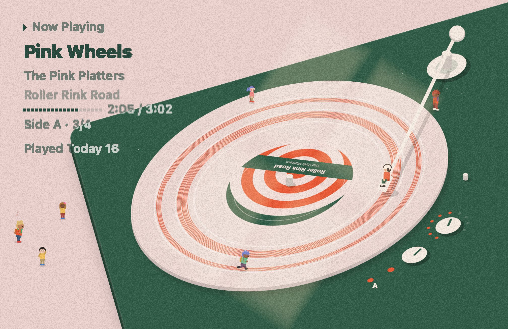

## Requirements

- macOS 14 Sonoma or later (Apple Silicon or Intel)
- Apple Music or Spotify

## Install

Download `TurnTable-<version>.zip` from the [latest release](https://github.com/soysaucecrab/todays-record-app/releases/latest), unzip it and move `TurnTable.app` to `/Applications`.

The app isn't notarized, so the first time you open it macOS will say it can't verify the developer. Click **Done**, then go to **System Settings → Privacy & Security** and click **Open Anyway**. You only have to do this once. If you'd rather use Terminal:

```sh
xattr -dr com.apple.quarantine /Applications/TurnTable.app
```

When the first song plays, macOS asks if TurnTable can control Music (or Spotify). It needs this to read the current track. It doesn't control playback and won't launch either app.

After that, updates come through the app (**Check for Updates…** in the menu, or automatically once a day).

## Features

- The album cover becomes the record label, and the colors of the whole scene come from it
- The needle moves inward as the song plays and draws a line in the album's color
- Albums are split into LP sides (up to 6 songs per side). Songs on the same side share a record; a new side flips it
- Volume knob follows the system volume, side lamps show which side you're on
- Light from a window moves across the desk with the time of day
- A small character sits on the needle. The longer you keep listening, the more people show up around the turntable (up to 6). They dance, read, doze off, talk on the phone, breakdance, play tag and run on the record. They leave one by one after the music stops
- Colors can be left to follow the album or set yourself: record, background, line, text, tonearm, the character's clothes, or colored vinyl in the album's color
- Record on the left, center or right, or a transparent background over your own wallpaper
- Works on multiple displays, avoids the menu bar and Dock, and clicks go through to the desktop
- Stops drawing when the screen is locked, asleep or covered; 30 fps on battery

## Screenshots

Time of day:

| | |
|---|---|
| 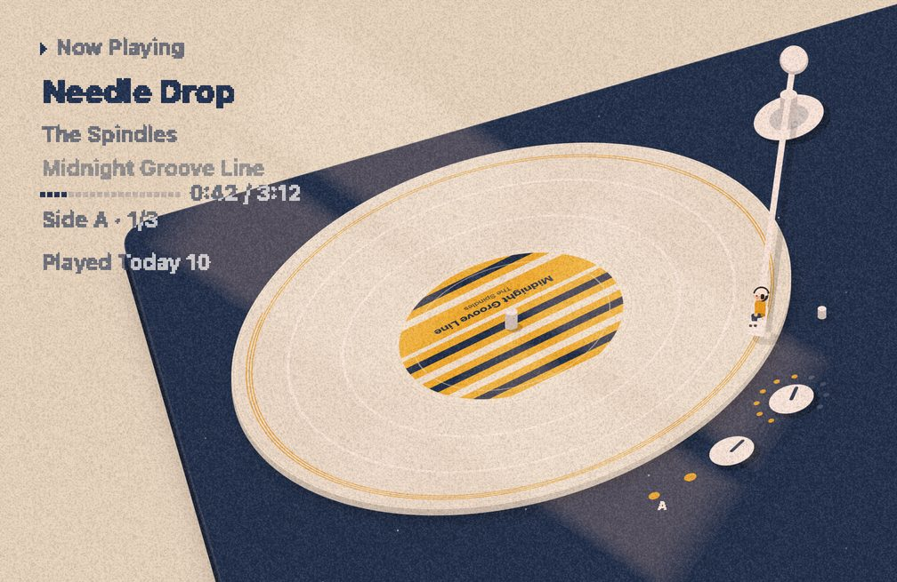 | 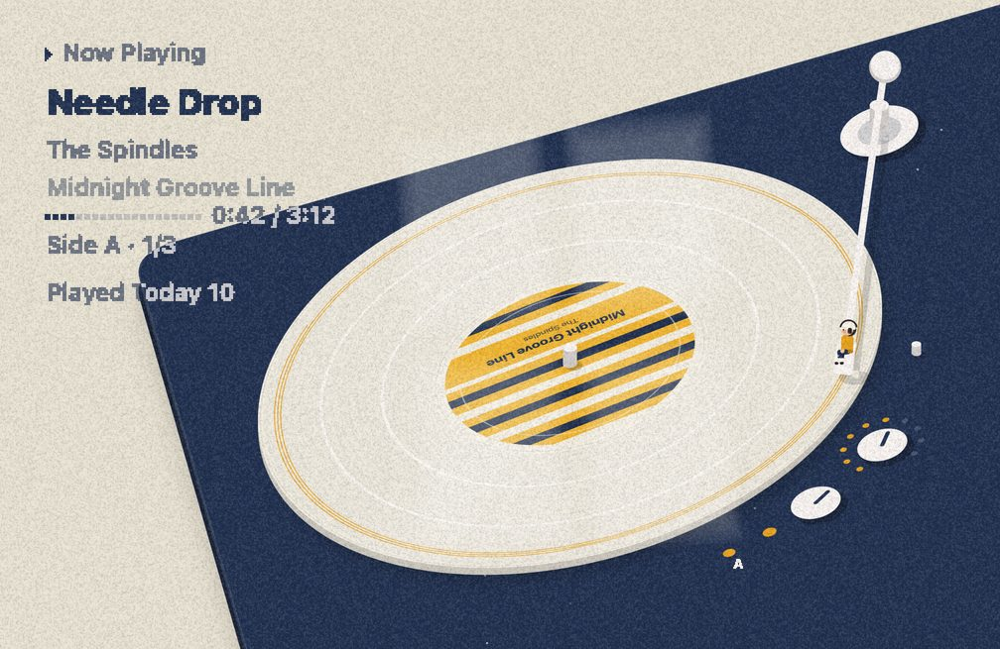 |
| 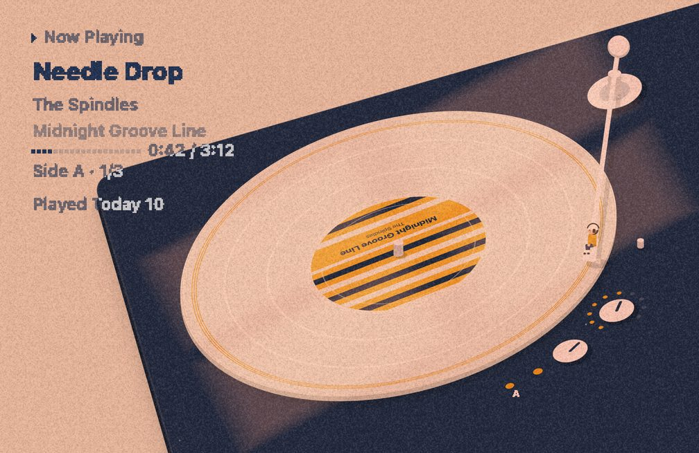 | 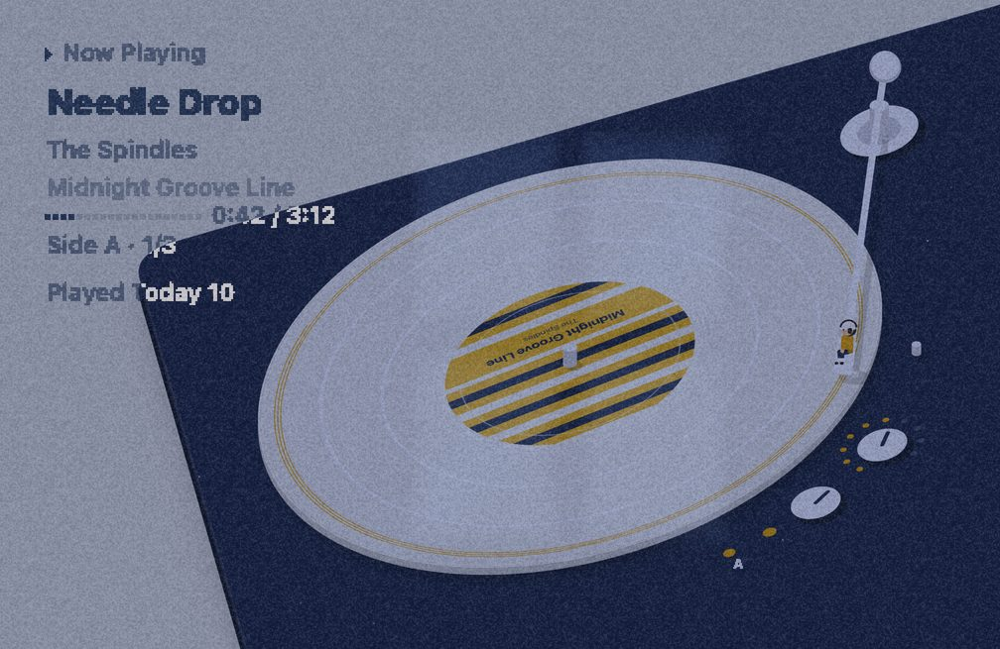 |

Colors and layout (colored vinyl, a black record with a gold tonearm, record on the left):

| | | |
|---|---|---|
| 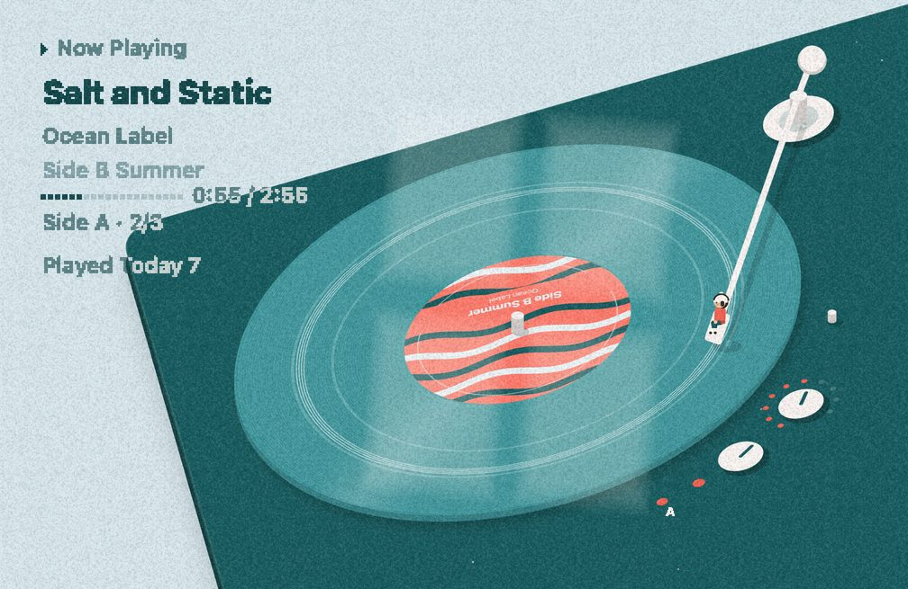 | 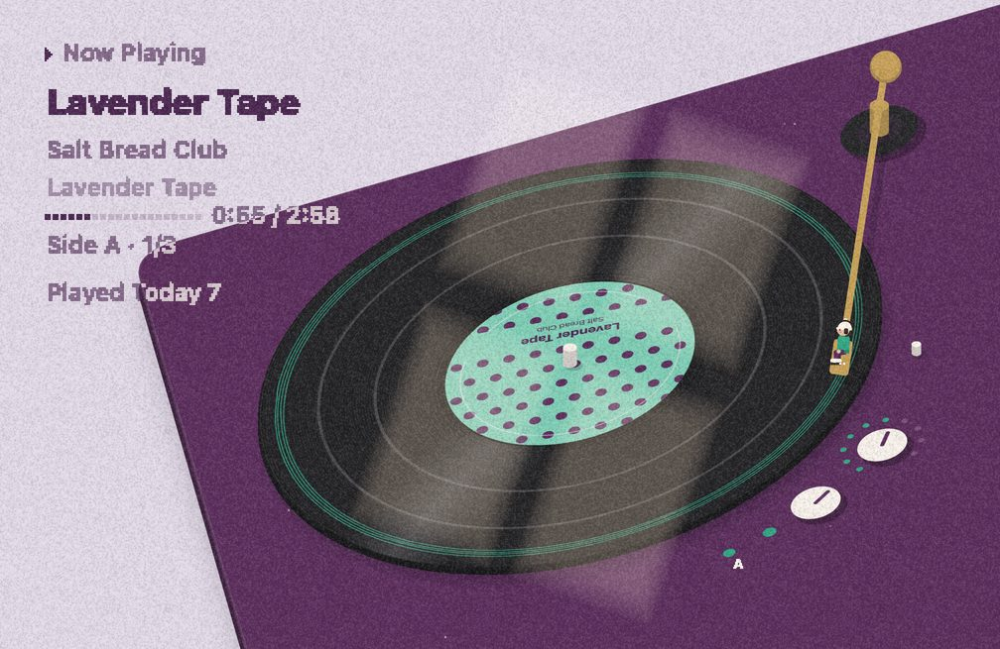 | 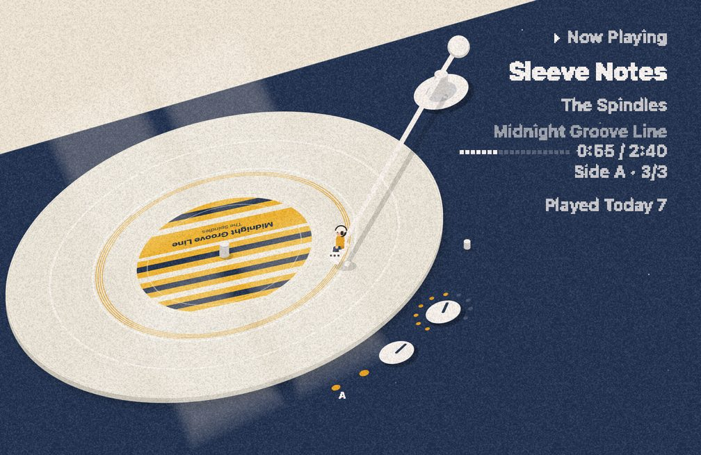 |

Up close, and some of the visitors:

<p>
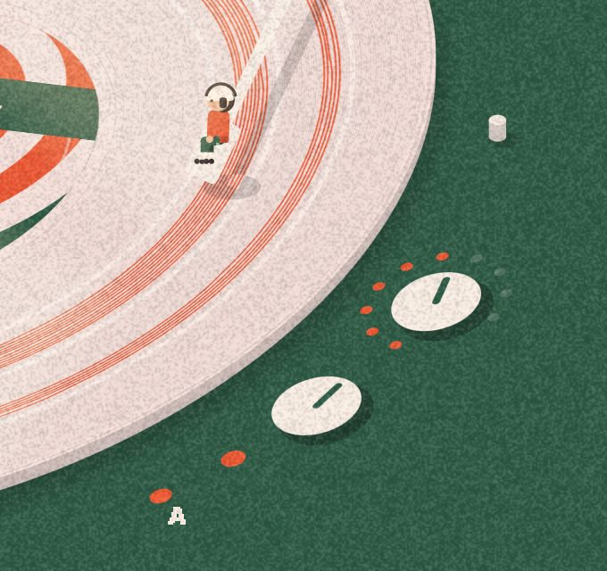

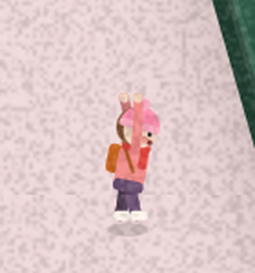
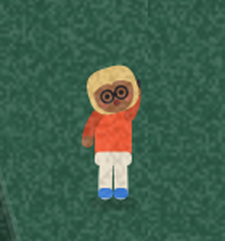
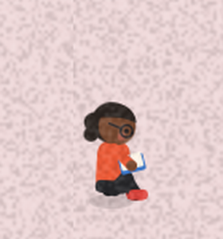
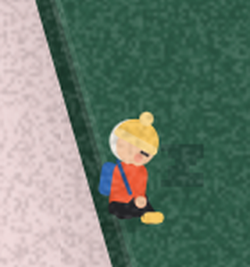
</p>

Settings:

| | |
|---|---|
| 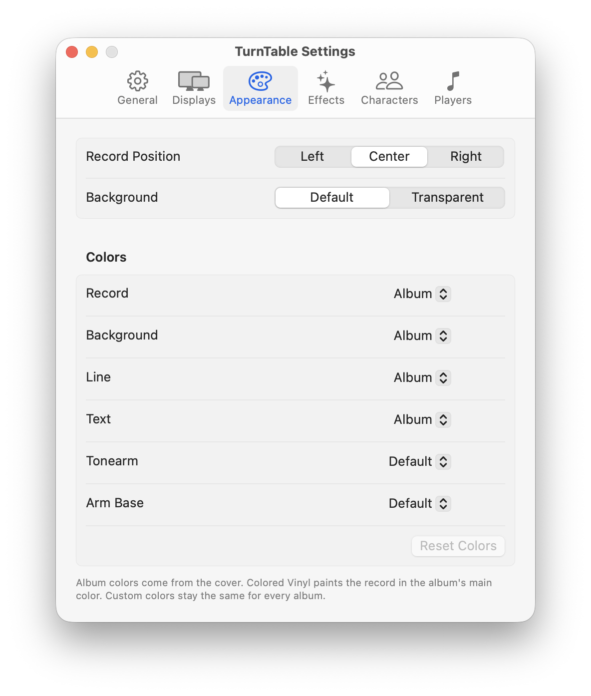 | 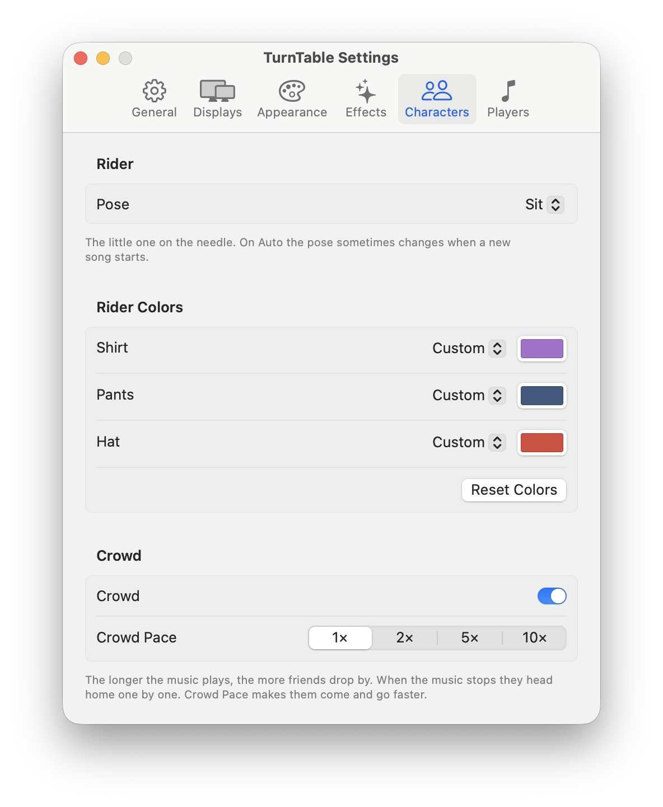 |
| 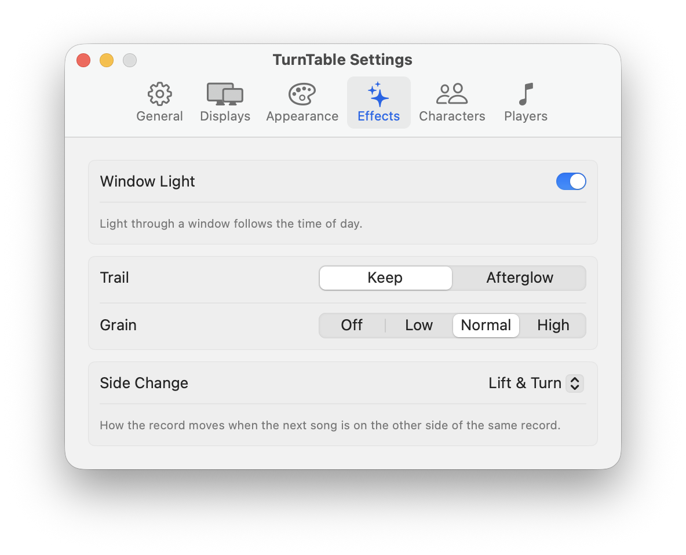 | 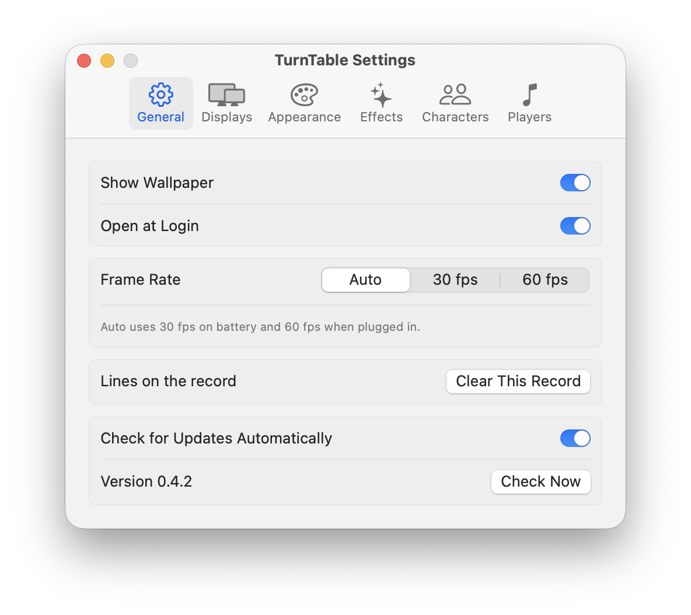 |

The albums in the screenshots are the app's built-in preview albums.

## Usage

TurnTable runs from the menu bar (the record icon). The menu has the current song, **Show Wallpaper**, **Clear This Record**, **Settings…**, **Check for Updates…** and, if both Music and Spotify are open, a **Player** submenu to pick one.

Everything else is in Settings:

| Tab | |
|---|---|
| General | Show wallpaper, open at login, frame rate, updates |
| Displays | Which displays show the record |
| Appearance | Record position, transparent background, colors |
| Effects | Window light, trail (keep or afterglow), grain, how a side change looks |
| Characters | The character's pose and colors, crowd on/off and speed |
| Players | Music and Spotify permission status |

## FAQ

### Nothing shows up on the desktop

Make sure **Show Wallpaper** is checked in the menu and that the display is turned on in **Settings → Displays**.

### The song doesn't show up

Check **Settings → Players**. If it says *Not Allowed*, click **Open Automation Settings…** and turn TurnTable on. If TurnTable isn't in that list, reset the permission and open the app again:

```sh
tccutil reset AppleEvents com.todaysrecord.app
```

### Why aren't some albums split into sides?

Music doesn't give track numbers for streamed songs that aren't in your library, so TurnTable looks the album up in the iTunes catalog. If it can't find a matching edition, the record still plays, just without sides.

### An update failed

The app needs to be in a folder it can write to, usually `/Applications`. If it's running from Downloads it will offer to move itself. When an update fails, it shows the reason; you can always download the zip from the releases page instead.

### I had 오늘의 판 installed

That's the old name. Updating from 0.4.x renames `TodaysRecord.app` to `TurnTable.app` and keeps your settings and permissions.

### How do I uninstall it?

Quit the app and delete it from `/Applications`. To remove its settings too:

```sh
defaults delete com.todaysrecord.app
```

## Building

Requires Xcode or the Command Line Tools. There are no third-party dependencies.

```sh
swift build
swift test
scripts/install.sh            # build, sign, install to /Applications and open
scripts/run.sh --demo         # run with the preview albums (no Music needed)
scripts/package.sh            # release zips in dist/
```

The app is AppKit + a WKWebView. The turntable itself is drawn on a canvas in [`Resources/index.html`](Resources/index.html), and the people around it are in [`Resources/crowd.js`](Resources/crowd.js). The full spec (in Korean) is in [`docs/SPEC.md`](docs/SPEC.md), and [`docs/claude-code-guide.md`](docs/claude-code-guide.md) has notes on how the app was built with Claude Code.
